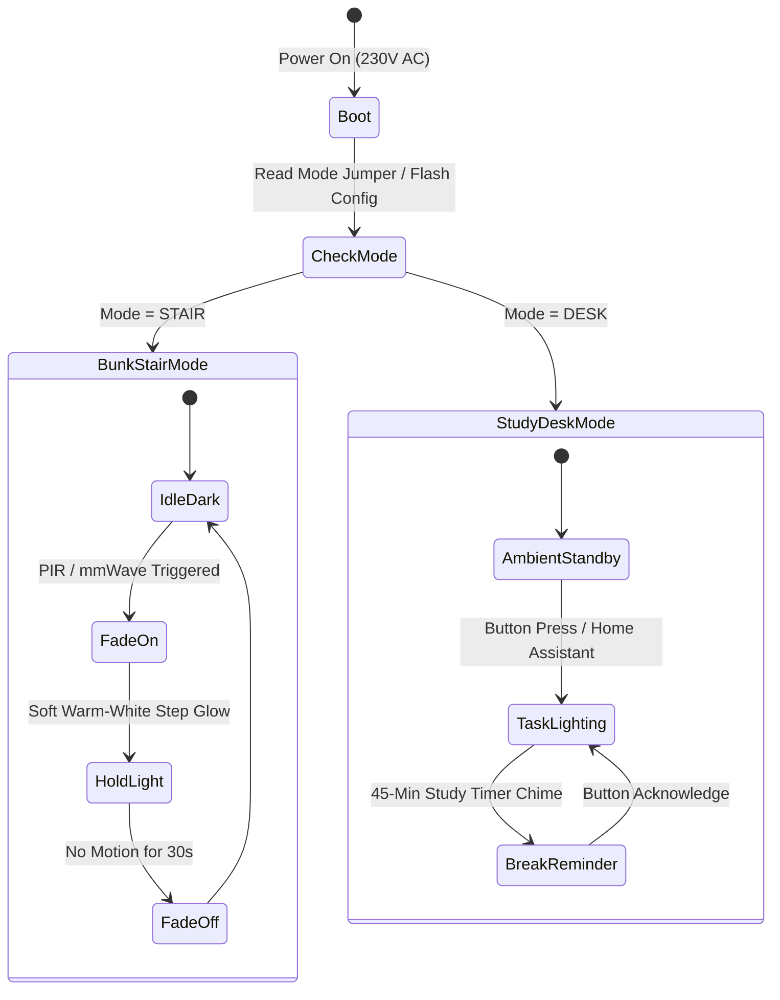

# System Architecture: Step & Study Hub

## 1. Hardware Block Diagram
The board is divided into an **AC Mains Primary Zone (230V AC)** and a **Reinforced-Isolated Secondary Zone (5V / 3.3V DC)** separated by a >= 5.0 mm creepage barrier and a 1.5 mm milled PCB slot.

```mermaid
flowchart LR
    subgraph Primary ["230V AC Primary Zone (High Voltage)"]
        AC["230V AC Input<br/>Screw Terminal"] --> FUSE["1A Slow-Blow Fuse<br/>+ 10D471K MOV"]
        FUSE --> EMI["EMI Filter<br/>X2 Cap + CM Choke"]
    end

    EMI ==>|"Reinforced Isolation<br/>(>= 5.0mm Gap + Slot)"| HLK["Hi-Link HLK-PM01<br/>230V AC to 5V DC"]

    subgraph Secondary ["Low-Voltage Secondary Zone (Touch-Safe)"]
        HLK -->|"5V Rail (600mA)"| LDO["3.3V LDO Regulator<br/>(AP2112K / AMS1117)"]
        HLK -->|"5V Power"| LS["5V Level Shifter<br/>(74AHCT1G125)"]
        
        LDO -->|"3.3V Rail"| MCU["ESP32-C3 / S3<br/>Controller Module"]
        
        MCU <-->|"I2C (SDA/SCL)"| SENS["Study Desk Sensors<br/>Temp/Hum/Lux (Qwiic)"]
        MCU <--|"3.3V GPIO"| PIR["Stair Motion Sensor<br/>PIR / mmWave"]
        MCU <--|"3.3V GPIO"| BTN["User Tactile Button<br/>& Piezo Buzzer"]
        MCU -->|"3.3V Data"| LS
        LS -->|"5V Data + 5V Power"| LED["WS2812B LED Strip<br/>(Stair / Desk Light)"]
    end

    style Primary fill:#ffe6e6,stroke:#cc0000,stroke-width:2px
    style Secondary fill:#e6f3ff,stroke:#0066cc,stroke-width:2px
```

## 2. Power Budget Breakdown

| Rail | Source | Max Available | Typical Load | Consumers |
| :--- | :--- | :--- | :--- | :--- |
| **230V AC** | Mains Input | 1A (Fused) | ~25 mA | Hi-Link HLK-PM01 AC-DC Module |
| **5.0V DC** | HLK-PM01 | 600 mA (3W) | ~350 mA | WS2812B LEDs (brightness-capped in firmware), 3.3V LDO |
| **3.3V DC** | 3.3V LDO | 600 mA | ~120 mA | ESP32 Wi-Fi active, PIR/mmWave sensor, I2C sensors |

## 3. Dual-Mode Operating States


