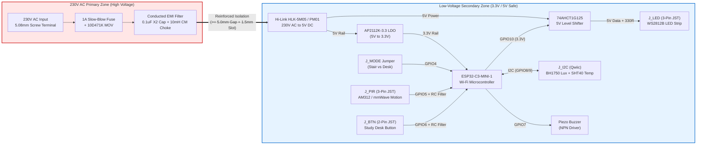
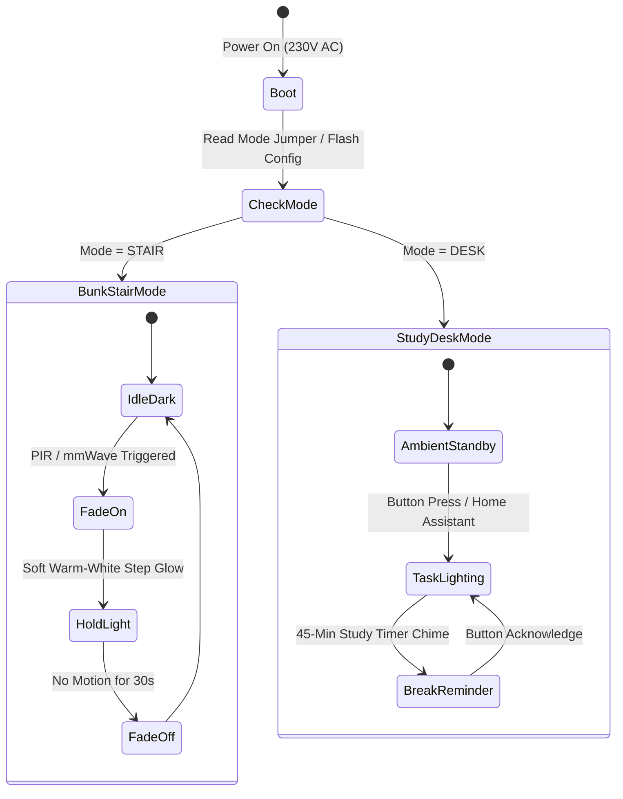

# System Architecture: Step & Study Hub

## 1. Hardware Block Diagram
The board is divided into an **AC Mains Primary Zone (230V AC)** and a **Reinforced-Isolated Secondary Zone (5V / 3.3V DC)** separated by a >= 5.0 mm creepage barrier and a 1.5 mm milled PCB slot.

## 2. Power Budget Breakdown

| Rail | Source | Max Available | Typical Load | Consumers |
| :--- | :--- | :--- | :--- | :--- |
| **230V AC** | Mains Input | 1A (Fused) | ~25 mA | Hi-Link HLK-PM01 AC-DC Module |
| **5.0V DC** | HLK-PM01 | 600 mA (3W) | ~350 mA | WS2812B LEDs (brightness-capped in firmware), 3.3V LDO |
| **3.3V DC** | 3.3V LDO | 600 mA | ~120 mA | ESP32 Wi-Fi active, PIR/mmWave sensor, I2C sensors |

## 3. Dual-Mode Operating States

## 4. Microcontroller Pin Allocation Table (ESP32-C3-MINI-1)
Locking in pin assignments before schematic capture prevents strapping-pin boot conflicts:

| ESP32-C3 Pin | Net Name | Sheet | Direction | Function & Notes |
| :--- | :--- | :--- | :--- | :--- |
| **GPIO4** | `MODE_SEL` | `sheet_mcu_core` | Input (Pull-up) | Closed to `GND` = Stair Mode; Open = Desk Mode |
| **GPIO5** | `PIR_IN` | `sheet_sensors` | Input | Motion sensor trigger (`1k` + `100nF` low-pass filter) |
| **GPIO6** | `BTN_IN` | `sheet_sensors` | Input (Pull-up) | Desk tactile switch (`10k` + `100nF` debounce) |
| **GPIO7** | `BUZZER_PWM` | `sheet_outputs` | Output | PWM tone output to MMBT2222A buzzer driver |
| **GPIO8** | `I2C_SDA` | `sheet_sensors` | Bidir | I2C Data (`4.7k` pull-up to `+3V3`) |
| **GPIO9** | `I2C_SCL` | `sheet_sensors` | Output | I2C Clock (`4.7k` pull-up to `+3V3`, also Boot strapping pin) |
| **GPIO10** | `LED_DATA_3V3` | `sheet_outputs` | Output | Feeds `74AHCT1G125` buffer -> `5V` WS2812B data |
| **EN / GPIO9** | `RESET` / `BOOT` | `sheet_mcu_core` | Input | On-board tactile buttons + 4-pin UART header for flashing |